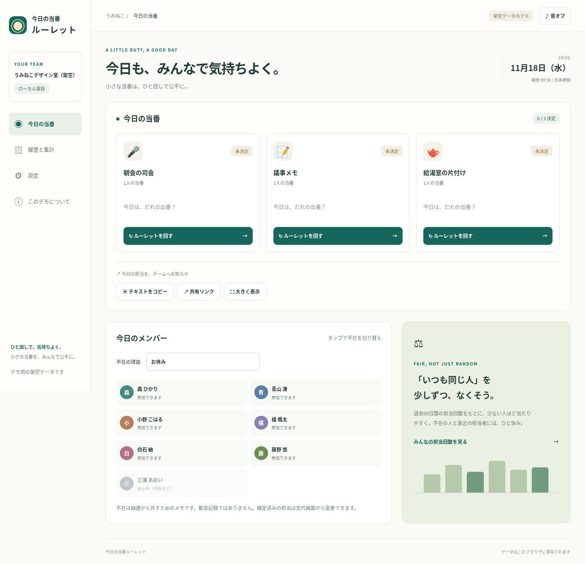

# 今日の当番ルーレット

## 概要

小さなチームの「今日のちょっとした当番」を、公平なルーレットで決めるアプリです。
朝会の司会・議事メモ・ゴミ出し・給湯室の片付け・買い出しを、担当回数や不在を考慮して抽選し、その日の担当を共有できます。
日本語UI、スマホのタブバー、デスクトップのサイドバーに対応しています。

## 主な機能

### 1. メンバーと当番の設定

- メンバーの追加・名前と色の編集・並べ替え・休止／再開。アバターは頭文字と色で表示します。
- 当番の追加・編集、絵文字1つ、担当人数1〜2人、実施曜日、対象メンバー、直近回避回数。
- 今日の不在をワンタップで切り替え、理由を入力。期間指定の不在も登録できます。
- チーム名、営業日、朝会の時刻、担当回数を参照する期間を設定できます。
- 設定・履歴・不在・回し直し／交代の記録をJSONで書き出し、検証と内容確認の後に読み込めます。

### 2. 公平なルーレット

- SVGのホイールが3秒かけて減速し、担当候補を表示。動きを抑える設定では180msに短縮します。
- Web Audio APIでカチカチ音と決定音を合成。既定はオフで、切り替えを保存します。
- 回す前に全メンバーの担当回数・当選確率・除外理由を表示します。
- 確定するまでは仮の結果です。理由を入力して回し直せます。1日の回し直し回数も表示します。
- 確定後は交代先と理由を指定できます。回し直し・交代とも、前後の担当と理由を記録します。
- 人数不足の場合は理由を表示し、抽選できない条件を勝手に解除しません。

### 3. 担当回数の履歴

- 日付・時刻・当番・担当者・決め方・メモの一覧。期間・当番・メンバーで絞り込みできます。
- メンバー×当番の回数表、合計回数の棒グラフ、最多と最少の差、平均からのずれ（標準偏差）。
- 対象になった日数あたりの担当回数を表示します。
- 履歴と回数表をBOM付きCSVでダウンロード。ファイル名には絞り込み期間を含めます。
- 回し直し・交代の監査記録は履歴画面の展開欄で確認できます。

### 4. 今日の当番の共有

- ホームに実施日の当番を一覧表示。まだ担当が決まっていないものは「未決定」と表示します。
- 共有テキストをクリップボードへコピー。利用できない環境では選択可能なテキスト欄を表示します。
- 対応ブラウザではWeb Share APIから共有できます。
- 日付・チーム名・当番・担当者だけを含む共有リンクを生成。保存データのない端末でも表示できます。
- 共有リンクは作成時点の内容を表示する読み取り専用ページです。後の変更は自動反映されません。
- 会議室のモニター向けに、文字を大きくした表示を用意しています。

## 公平性のしくみ

同じ当番について、抽選日の前日までの担当回数を、設定した参照期間（既定60日、当日を含む暦日範囲）で数えます。
候補者の最少回数を基準に、次の重みを使用します。

```text
重み = 1 / (1 + 担当回数 − 候補者の最少回数)
1人の当選確率 = 自分の重み / 候補者全員の重みの合計
```

担当回数が少ない人ほど当たりやすくなります。結果を同じ回数に強制するものではありません。
乱数は `crypto.getRandomValues` で生成し、抽選関数には乱数関数を引数として渡します。
テストでは固定値や再現可能な乱数列を使い、実際の抽選ではシード乱数を使用しません。

2人当番は重み付き抽選を1人ずつ実行し、選んだ人を候補から外します。
表示する確率は「2人のいずれかに選ばれる確率」です。候補者iの重みをwi、重みの合計をWとすると、
`wi/W + Σ(j≠i) (wj/W × wi/(W−wj))` で計算し、合計は200%になります。
ホイールの扇は読みやすさのため均等サイズで、当選確率を面積では表しません。針は1人目を示します。

除外の条件は次のとおりです。

- 休止中、参加日前、当番の対象メンバーではない。
- 当日が不在期間の開始日〜終了日（両端を含む）に入っている。
- 同じ当番の直近N回の担当者に含まれる。Nは日数ではなく実施回数です。
- 「同じ日に同じ人へ当番を重ねない」がオンで、すでに別の当番が確定している。

同日重複を避けると必要人数に満たない場合だけ、同日重複を許可し、その旨を表示します。
不在・休止・対象外・直近回避は解除しません。それでも足りなければ抽選を停止し、設定の見直しを案内します。
交代先にも同じ除外条件を適用し、同じ当番の2人に同一人物を指定できません。

対象日数は、現在の有効設定・参加日・当番の曜日／対象メンバー・チームの営業日／休業日・登録済み不在を使用して、期間内にいずれかの対象当番があった日を数えます。
同日の当番が複数あっても1日と数えます。直近回避と同日重複は対象日数に含めません。
設定変更前の有効状態・曜日・対象設定は保存していないため、対象日数と日数あたりの回数は現在設定による参考値です。
偏りの指標は、有効かつ対象日数が1日以上のメンバーを比較します。
交代した履歴の担当回数は、交代後の担当者に計上します。

## 日付の扱い

- 日付は日本時間の `YYYY-MM-DD`、時刻は `HH:MM` で保存します。今日の日付はクライアントのマウント後に確定し、開いたまま日付が変わった場合も更新します。
- 既定の営業日は月〜金です。営業日と当番の実施曜日の両方に一致し、チーム休業日ではない日に実施します。
- 初回生成の日時が朝会（既定9:30）より後で、当番のある日なら、朝会の司会と議事メモだけを決定済みにします。
- 0時台・早朝・朝会前は今日の当番がすべて未決定です。土日は当番がなく、次の営業日を表示します。
- 履歴と監査記録は現在より前の日時で生成します。将来の期間不在も1件用意します。
- シードには相対日付の「チームの休業日」を1日置き、実在の祝日表は持ちません。
- 既存の保存データを開いたときに今日の担当を自動決定することはありません。

## 既存作品との違い

| 既存作品                 | 本作との違い                                                                                         |
| ------------------------ | ---------------------------------------------------------------------------------------------------- |
| シフト管理システム       | 勤務時間帯・必要人数・希望休・労働時間の制約を扱いません。当日のちょっとした当番の担当者を決めます。 |
| 人・ロボットシフト管理   | 人やロボットの勤務配置は作成しません。チーム内の当番の公平な抽選が中心です。                         |
| 勤怠管理システム         | 出退勤の打刻や勤務時間を集計しません。不在は抽選から外すためのメモです。                             |
| 開店・閉店チェックリスト | 作業チェック・実施記録・申し送りは管理しません。担当者を決めるところまでです。                       |
| 3でアホる DARTS          | ゲームのスコア計算はありません。ルーレットの演出は日常の当番決めを楽しくするためのものです。         |

## 画面一覧

| パス             | 内容                                           |
| ---------------- | ---------------------------------------------- |
| `/`              | 今日の当番、不在の切り替え、共有               |
| `/spin/[dutyId]` | 確率と除外理由、抽選、確定、回し直し、交代     |
| `/history`       | 履歴・集計・CSV・監査記録                      |
| `/settings`      | メンバー・当番・期間不在・公平性・バックアップ |
| `/share?data=…`  | URLの内容だけで表示する読み取り専用の当番一覧  |
| `/board`         | このブラウザの今日の当番を大きく表示           |
| `/about`         | デモ説明、保存先、既定データへのリセット       |

## データの保存先

このブラウザのlocalStorage（キー `dtr:v1`）だけに保存します。
認証・外部API・DB・サーバー保存・メール・プッシュ通知は使用しません。外部Webフォントや音声ファイルも使用しません。
保存時にブラウザが書き込みを拒否した場合は通知し、バックアップを案内します。
壊れた保存データは検証で検出し、既定データに戻したことを通知します。
バックアップの読み込みではバージョン・型・日付・時刻・参照ID・重複・上限を検証し、不正なファイルは適用しません。
共有リンクには日付・チーム名・当番・担当者がURL内に含まれ、リンクを知る人が閲覧できます。

## 技術スタック

- Next.js 16（App Router）、React 19、TypeScript
- Tailwind CSS 4の既存環境、セクションごとに分割したCSS
- SVG、Web Audio API、Web Crypto API、Clipboard API、Web Share API
- ESLint、Prettier 3（printWidth: 100）
- Node.js標準テストランナー。既存のTypeScriptをメモリ内で変換して純粋関数を検証するため、追加のテストパッケージは不要です。

## 公開URL

[今日の当番ルーレット](https://duty-roulette.vercel.app)

## スクリーンショット



02（ルーレット）と04（共有リンクの表示）はスマートフォン表示（390×844）、01・03・05はPC表示（1440幅）です。

| 画面       | 画像                                                |
| ---------- | --------------------------------------------------- |
| 今日       | [01-today.png](docs/screenshots/01-today.png)       |
| ルーレット | [02-spin.png](docs/screenshots/02-spin.png)         |
| 履歴と集計 | [03-history.png](docs/screenshots/03-history.png)   |
| 共有       | [04-share.png](docs/screenshots/04-share.png)       |
| 設定       | [05-settings.png](docs/screenshots/05-settings.png) |

## ローカル起動方法

Node.js 22以降を使用し、このプロジェクトの直下で実行します。

```bash
npm install
npm run dev
```

ブラウザで `http://localhost:3000` を開きます。

```bash
npm run lint
npm run typecheck
npm test
npm run build
npm start
```

コードの整形は次のコマンドです。Prettierを依存関係に追加する必要はありません。

```bash
npx --yes prettier@3 --write "src/**/*.{ts,tsx,css}" "tests/**/*.js" README.md
```

`next.config.ts` の `turbopack: { root: process.cwd() }` は、このプロジェクト直下をルートとして扱うための設定です。
`.env*`・`.vercel`・`node_modules`・`.next`・`*.tsbuildinfo`・`.cache/` はGitの追跡対象外です。

## デモデータについて

チーム名・7名の名前・5種類の当番・不在理由・履歴はすべて架空で、実在の企業・個人とは無関係です。
日付は開いた日からの相対で、過去55日間（約8週間）の履歴を生成します。
同じ順番のローテーションではなく、重み付きの抽選と全体回数の緩やかな補正を組み合わせ、直近回避・不在を守りながら自然なばらつきを作ります。
シード専用の再現可能な乱数を使うため、同じ日時を渡すと同じデータになります。
決定時刻は9:20〜9:45の範囲で変化し、回し直し・交代・チーム休業日も含みます。
「このデモについて」画面で既定データに戻すと、その時点の日本時間を基準に再生成します。
